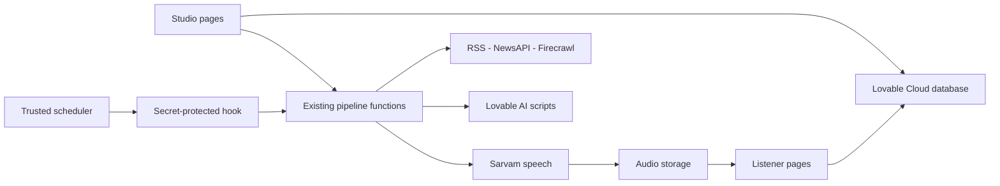

# Tamil AI Vanoli

Original AI-powered Tamil internet radio with a listener experience and a news-to-audio studio.

> **Status: MVP foundations, not production-ready.** Real news, AI script and speech integrations exist. Authorization, approval handling, audio assembly and reliable scheduling still need work. This README describes checked-in code, not certified hosted behavior.

## Documentation

- [Progress and release gaps](docs/PROGRESS.md)
- [Operating flows](docs/FLOWS.md)
- [Current pipeline](docs/diagrams/current-pipeline.mmd)
- [Target release flow](docs/diagrams/target-release-flow.mmd)

## Implemented scope

| Area | Present | Limitation |
| --- | --- | --- |
| Listener | Home, shows, city selection, replay, scripts, source links, requests | Latest episode, not continuous live broadcast; absent audio means silent mock progress |
| Studio | Sources, manual news, script previews, episode controls, voices, manual pipeline run | No complete sign-in gate, dedicated approval queue, show editor or schedule editor |
| Collection | RSS/Atom, NewsAPI, manual Firecrawl extraction | No GDELT or automatic Firecrawl stage |
| Scripts | Lovable AI generation, seven original show formats | No independent JSON, fact or citation validation |
| Speech | Sarvam bulbul:v2 and WAV storage | Raw byte concatenation, not validated media mixing |
| Automation | Pipeline function, run logs, secret-protected hook | No cron job definition in migrations; stored show times are not consumed |
| Safety | Disclosure, source links, sensitive-category flags, episode read policies | Manual generation and approval handling have enforcement gaps |

## Architecture

Frontend: TanStack Start / Router, React 19, TypeScript, Tailwind CSS 4 and Sonner. Backend: Lovable Cloud database, authentication and audio storage. Existing integrations are under `supabase/functions/`; browser calls use `src/lib/fn.ts`. A TanStack server route forwards trusted cron requests.



This describes the current architecture. Future internal backend additions should follow the project's TanStack server-function conventions rather than adding legacy function endpoints.

## Pages

| Address | Purpose |
| --- | --- |
| `/` | Latest episode player and channels |
| `/shows`, `/shows/$showId` | Shows and published episodes |
| `/episodes/$episodeId` | Replay, script and source links |
| `/schedule` | Stored show timings, displayed as IST |
| `/submit` | Listener request form |
| `/admin` | Studio and manual automation controls |
| `/api/public/hooks/auto-pipeline` | POST cron hook requiring `x-cron-secret` |

## Local development

Install Bun and Deno; Deno runs the pure parser tests.

```sh
bun install
bun run dev

# No network or provider credentials needed for these tests
deno test supabase/functions/fetch-news/parser_test.ts

bun run lint
bun run build
```

Use Vite's printed address. The Lovable workspace already runs its preview on port 8080. There is no package test script or checked-in deployment test gate. Add the parser command to CI before deploying. **Local result on 2026-10-25: 10 passed, 0 failed.**

## Configuration

Keep private credentials in managed secrets, never in source or shared documents.

| Setting | Purpose |
| --- | --- |
| Generated public browser configuration | Managed Lovable Cloud connection; do not edit generated files |
| `LOVABLE_API_KEY` | Existing script and Firecrawl gateway calls |
| `SARVAM_API_KEY` | Sarvam speech |
| `NEWSAPI_KEY` | Optional NewsAPI collection |
| `FIRECRAWL_API_KEY` | Existing public extraction integration |
| `CRON_SECRET` | Trusted cron caller authentication |

The current hook also expects backend URL and privileged-key server environment variables. Their availability is unverified; privileged credentials are not user-accessible on Lovable Cloud. This is a release integration gap, not a request to fetch keys manually.

Provider balances, hosted schema, deployed endpoint configuration and active cron jobs were not checked in this documentation task.

## Data

Core tables: `sources`, `news_items`, `shows`, `episodes`, `voices`, `schedules`, `user_requests`, `moderation_flags`, `profiles`, `user_roles`, `pipeline_runs`. Scripts are stored on episodes; there is no separate generated-script persistence module.

Migrations include schema, policies, audio storage, approval flags and cron extensions. Fresh-install drift remains in source credibility/type fields and voice pace queries; see the progress report before a clean deployment.

## Editorial requirements

- Original names, voices, scripts and jingles only; do not imitate existing FM brands or personalities.
- Store titles, short summaries, metadata, URLs and original scripts, not full articles.
- Display source links for factual episodes.
- Required label: **“AI-generated radio content based on public sources and verified inputs.”**
- Political, crime, religion, caste, health, legal, finance, emergency and other sensitive content needs explicit admin approval.
- No hate speech, defamation, fake claims, caste/religion jokes or comedy treatment of serious news.
- Public extraction must not bypass paywalls, login barriers or site restrictions.

These are requirements, not a claim of complete enforcement.

## Before production release

1. Secure privileged endpoints and add real admin session/role checks.
2. Repair manual and automated approval paths; keep review audio private.
3. Reconcile migrations and validate model outputs and factual references.
4. Replace byte concatenation with tested audio assembly.
5. Add queued execution, bounded requests, retries, idempotency and persisted cron provisioning.
6. Verify generation → review → publish → audible listener replay end-to-end.