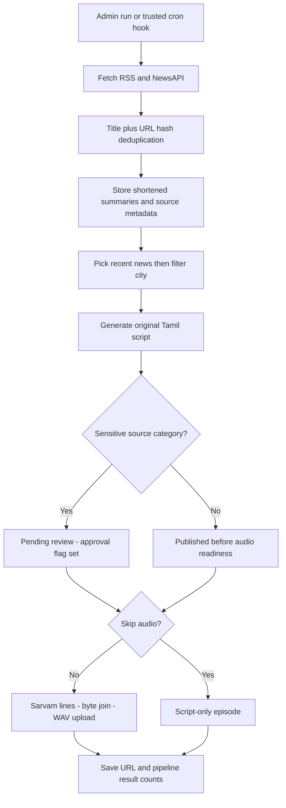

# Tamil AI Vanoli — Flow document

**Reviewed: 2026-10-25.** Current behavior is separated from the planned release flow. Diagrams do not imply hosted automation has been verified.

## 1. Listener journey

1. Open Home. Active shows and up to 12 recent published episodes are queried.
2. Choose a city. Filtering occurs after the initial episode limit.
3. The player selects a matching recent episode, otherwise the newest available episode.
4. With an audio URL, the browser plays audio. Without one, the player advances silently in mock mode.
5. Open an episode for its original script and source links. Playback ends rather than advancing through a broadcast playlist.

This is episode playback, not a 24/7 live stream.

## 2. Manual editorial journey

1. Studio → Sources: add an RSS/API/manual/Firecrawl source. Actual availability depends on schema and provider configuration.
2. Fetch RSS/NewsAPI, manually extract an approved public page, or add manual news.
3. Studio → Generate script: select a show and source items, enter approved notes, request a Tamil script and preview references.
4. Save for review or use the existing publish action. Sensitivity enforcement on this path is incomplete; do not treat it as a safe production approval gate.
5. Studio → Episodes: generate audio and preview it, publish or reject. Flagged automated episodes currently remain hidden because Publish does not clear their approval flag.

## 3. Current automatic flow

The editable diagram is [current-pipeline.mmd](diagrams/current-pipeline.mmd).

Manual news and manual Firecrawl extraction feed the same news table; they are not automatic collection stages in this pipeline.

### Run controls

Studio → Overview → **Run auto-pipeline now** accepts optional show/city, maximum news and skip-audio settings. Results include fetched news, episodes, pending approval, generated audio and errors. The UI explicitly sends skip-audio; do not assume the function's bulk default applies to UI runs.

The function defaults to three news items and a 120-second soft deadline. No show filter means active shows are processed. City means requested city, show city or Chennai—not every city. Bulk calls without an explicit skip setting omit audio by default.

### Failure behavior

- Collection can fail and script generation can continue with stored items.
- Individual source failures may not change the run's overall result.
- The deadline is checked between steps, not an abort signal for network requests.
- Episodes may already be inserted/published before audio fails.
- There is no durable queue or automatic resume, rollback or duplicate-run lock.

## 4. Episode state model

| State | Current entry | Listener eligibility |
| --- | --- | --- |
| `draft` | Supported by schema | Not public |
| `pending_review` | Save-for-review or sensitive automatic script | Not public |
| `approved` | Supported by schema; no separate working approval transition | Not public under current policy |
| `published` | Manual publish or nonsensitive automatic insertion | Public only when `requires_approval = false`; audio can still be absent |
| `rejected` | Admin reject action | Not public |

Public episode policy allows published/unflagged rows, with an admin exception. Known public audio URLs are separately accessible; row visibility is not media privacy.

## 5. Scheduling flow today

The schedule page reads active stored timings and labels them IST. Those records do not determine the player's episode or pipeline execution. The public cron hook checks a shared secret then forwards a request. Migrations enable scheduler extensions but do not create the timed job. Hosted hourly jobs mentioned previously remain unverified.

## 6. Target production flow — not implemented

See [target-release-flow.mmd](diagrams/target-release-flow.mmd).

Authenticated operation → validated collection → original short summaries → unique deduplication → eligible city/show sources → validated script and citations → moderation → explicit sensitive-content review → queued Sarvam synthesis → decoded/mixed/validated audio → private preview → scheduled publication → audible listener playback with references.

Reject stops publication. Publish requires review completion where needed and valid audio. Retries must be bounded and idempotent. All sensitive operations need endpoint-level authorization, even when the studio page itself is protected.

## 7. Operating checks

For silent playback, first confirm that the episode has an audio URL; animated progress alone proves nothing. Generate a short episode only after provider access and admin authorization are verified, inspect its media output, then test full playback. Multi-line WAV assembly currently needs repair.

For a timeout, inspect the run's partial counts and existing episodes before rerunning. Prefer a selected show/city and skip audio when diagnosing collection/script steps; this reduces work but is not a guaranteed timeout fix.

For approval problems, inspect both status and approval flag. Do not bypass restrictions to make a flagged episode audible; repair the review transition and media privacy first.

For deployment confidence, run the parser suite, reconcile migrations, verify cron configuration and exercise generation → review → publish → listener replay with a real authorized session. Source inspection alone does not verify that flow.